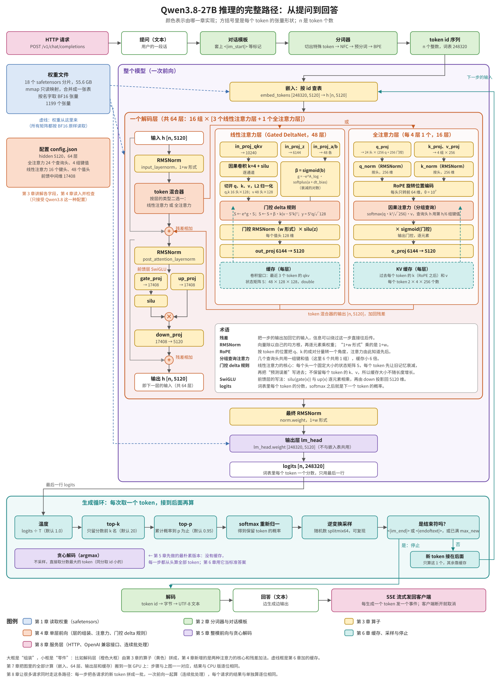

# Build an LLM Inference Engine (From Scratch)

从零构建大模型推理引擎。

这是一本边写代码边写成的书。目标是用 C 和 CUDA，从读取权重文件开始，一步步写出一个能跑开源大模型的推理引擎。读者只需要会 C 和 Python。

书和代码在同一个仓库里，写作顺序就是开发顺序。

## 一张图看全书

下图是本书实现的 Qwen3.8-27B 从提问到回答的完整路径，颜色表示每一部分由哪一章实现（第 1 到 6 章和第 8 章；第 7 章把全部计算搬到 GPU 上），图中有图例和术语解释。图由 `tools/gen_architecture.py` 生成。



## 代码在哪里

引擎的源代码按章节放在 `src/` 下，每章一个目录，目录里的 README 列出这一章写了哪些文件、后面的章节又在上面加了什么。后面的章节会扩展前面的文件（例如第 6 章给第 3 章的算子加上带缓存的版本），所以一个文件放在它第一次出现的那一章。对拍测试同样按章放在 `tests/` 下，命令行工具放在 `tools/`。

| 章 | 源代码 | 测试 |
| --- | --- | --- |
| 第 1 章 | [`src/01-weights/`](src/01-weights/) | [`tests/01-weights/`](tests/01-weights/) |
| 第 2 章 | [`src/02-tokenizer/`](src/02-tokenizer/) | [`tests/02-tokenizer/`](tests/02-tokenizer/) |
| 第 3 章 | [`src/03-ops/`](src/03-ops/) | [`tests/03-ops/`](tests/03-ops/) |
| 第 4 章 | [`src/04-layer/`](src/04-layer/) | [`tests/04-layer/`](tests/04-layer/) |
| 第 5 章 | 写在第 4 章的 `model.c` 里 | [`tests/05-model/`](tests/05-model/) |
| 第 6 章 | [`src/06-generate/`](src/06-generate/) | [`tests/06-generate/`](tests/06-generate/) |
| 第 7 章 | [`src/07-gpu/`](src/07-gpu/) | [`tests/07-gpu/`](tests/07-gpu/) |
| 第 8 章 | [`src/08-serve/`](src/08-serve/) | [`tests/08-serve/`](tests/08-serve/) |

## 状态

刚开始。正文和代码都是初稿，会随开发改动。

| 章 | 内容 | 状态 |
| --- | --- | --- |
| [前言](book/00-preface.md) | 目标、原则、路线 | 初稿 |
| [第 1 章](book/01-weights.md) | 读取权重文件（safetensors） | 初稿，已在 Qwen3-4B 和 Qwen3.8-27B 的全部权重上对拍 |
| [第 2 章](book/02-tokenizer.md) | 分词器（BPE、NFC、预分词、对话模板） | 初稿，已在小词表、全部 Unicode 码点和 Qwen3.8-27B 真实词表上对拍；对话模板与 transformers 对拍 |
| [第 3 章](book/03-ops.md) | 张量与算子（矩阵乘、两种 RMSNorm、激活、softmax、RoPE、因果卷积） | 初稿，已在小输入和 Qwen3.8-27B 的真实权重上逐元素对拍，误差不超过 0.5 ulp |
| [第 4 章](book/04-layer.md) | 单层前向（全注意力、门控 delta 规则的线性注意力、前馈层） | 初稿，已在随机小模型上通过两层对拍：逐步误差不超过 0.5 ulp，与官方 transformers（float64）的相对误差不超过 2.4e-4；在 Qwen3.8-27B 的四层真实权重上同样通过 |
| [第 5 章](book/05-model.md) | 整模前向（64 层、输出层、logits）与最朴素的贪心解码 | 初稿，已在 8 层随机小模型上通过两层对拍：逐步误差不超过 0.5 ulp，贪心解码的 token 与官方 transformers（float64）完全相同；在 Qwen3.8-27B 上 64 层逐层对拍通过，“中国的首都是”贪心生成的 8 个 token 与官方 float64 完全相同 |
| [第 6 章](book/06-generate.md) | 生成循环（KV 缓存与线性注意力的状态、温度/top-k/top-p 采样、结束符） | 初稿，已在 8 层随机小模型上通过：带缓存与不带缓存逐字节相同；采样与标准库参考实现逐 token 相同，分布与官方 logits 处理器一致，官方 generate 照同样的选择走时分布一致、停在同一处；在 Qwen3.8-27B 上带缓存与不带缓存逐位相同，按对话模板提问并采样，在 `<|im_end|>` 处停下 |
| [第 7 章](book/07-gpu.md) | 单卡 GPU 后端（朴素的 CUDA 内核：double 累加、与 CPU 相同的求和次序、关掉 FMA） | 初稿，第 3 到 6 章的全部测试换成 GPU 版后通过；GPU 的输出与 CPU 逐位相同（小模型上每层每一步，Qwen3.8-27B 上 64 层的输出和 logits），27B 每个 token 约 0.8 秒（CPU 13.3 秒） |
| [第 8 章](book/08-serve.md) | 服务层（OpenAI 兼容的 HTTP 接口、SSE 流式输出、断开即取消、连续批处理） | 初稿，在随机小模型上：任意到达次序、批大小 1/3/8 下，每个请求的 logits、分布、随机数和 token 都与单独生成逐字节相同；HTTP 端到端测试（流式、取消、44 种写坏的请求、官方 openai 客户端）通过；在 Qwen3.8-27B 上，GPU 版服务端同时回答 4 个问题（流式与非流式、贪心与采样），每个回答与单独生成逐 token 相同，用时 43 秒（逐个单独生成合计 100 秒） |

## 构建与测试

需要一个 C17 编译器、make 和 Python 3。第 1、3 章和第 4 章第一层对拍的测试只用 Python 标准库；第 4、5、6 章的第二层对拍要调用官方的 transformers 代码，需要 `torch` 和 `transformers`，没装时打印“跳过”；第 2 章的测试要和官方分词器对拍，需要 Hugging Face 的 `tokenizers` 库（在 0.21.4 到 0.23.3 上验证过，更早的版本预分词会有差异）。建议装在虚拟环境里，再用 `PYTHON` 指定它：

```
python3 -m venv ~/venvs/tok      # 或者 uv venv ~/venvs/tok
~/venvs/tok/bin/pip install "tokenizers>=0.21.4,<=0.23.3" transformers jinja2 torch
```

jinja2 只用于对话模板的对拍（transformers 不会自动装上它），torch 只用于第 4、5、6 章的第二层对拍；没装时对应的测试会打印“跳过”，其余测试照常运行。

```
make test PYTHON=$HOME/venvs/tok/bin/python            # 快速测试（第 1 到 8 章），几分钟
make test-unicode PYTHON=$HOME/venvs/tok/bin/python    # 第 2 章：全部 Unicode 码点的穷举对拍，几分钟
make test-real TOKENIZER=<模型目录>/tokenizer.json PYTHON=$HOME/venvs/tok/bin/python   # 第 2 章：在真实词表上对拍
make test-ops-real MODEL=<模型目录>                     # 第 3 章：拿真实权重当算子输入，十几秒
make test-layer-real MODEL=<模型目录> PYTHON=$HOME/venvs/tok/bin/python   # 第 4 章：在真实模型的四层上对拍，十几分钟
make test-model-real MODEL=<模型目录> PYTHON=$HOME/venvs/tok/bin/python   # 第 5 章：整个模型贪心生成 8 个 token 并对拍
make test-gen-real MODEL=<模型目录> PYTHON=$HOME/venvs/tok/bin/python     # 第 6 章：带缓存的贪心解码和对话采样，与不带缓存逐位对拍
```

如果系统的 `python3` 已经装了 `tokenizers`，可以省略 `PYTHON=`。

第 7 章的 GPU 版需要 NVIDIA 显卡和 CUDA 工具包（在 CUDA 13.1、RTX PRO 6000 Blackwell 上验证过）。CUDA 默认在 `/usr/local/cuda`，可以用 `CUDA=` 指定；显卡架构默认 `sm_120`，别的显卡用 `CUDA_ARCH=` 改。没有 CUDA 时前 6 章照常构建和测试。

```
make gpu                                                   # 构建 GPU 版到 build/gpu，工具和用法与 CPU 版相同
make test-gpu PYTHON=$HOME/venvs/tok/bin/python            # 第 3 到 6 章的测试换成 GPU 版再跑一遍，再与 CPU 逐层比较，两三分钟
make test-gpu-real MODEL=<模型目录> PYTHON=$HOME/venvs/tok/bin/python   # 第 7 章：在真实模型上验收 GPU 版，二十分钟左右
```

第 8 章的服务端提供 OpenAI 兼容的接口（`POST /v1/chat/completions`，支持流式），为 OpenAI 写的客户端改一下地址就能用：

```
make gpu
M=/data/models/Qwen3.8-27B
build/gpu/serve $M/config.json $M/generation_config.json $M/tokenizer.json $M/chat_template.jinja $M/*.safetensors
curl -N localhost:8000/v1/chat/completions -d '{"model":"qwen3.8-27b","stream":true,
     "messages":[{"role":"user","content":"中国的首都是哪里？"}],"chat_template_kwargs":{"enable_thinking":false}}'
make test-serve-real MODEL=<模型目录> PYTHON=$HOME/venvs/tok/bin/python   # 第 8 章：几个问题同时发给服务端，与逐个单独生成对拍
```

想自己向模型提问，也可以用 `tools/ask.sh`。它套上对话模板，用第 6 章的生成循环边生成边打印（另建一份 `-O2`、不带 ASan 的程序到 `build/fast`）。CPU 版是单线程，每个 token 约 13.5 秒，一个问题要好几分钟；加 `-G` 在 GPU 上算（第 7 章），每个 token 约 0.8 秒：

```
tools/ask.sh "中国的首都是哪里？"                  # 默认用 /data/models/Qwen3.8-27B，可用 MODEL=<模型目录> 指定
tools/ask.sh -n 200 -s 42 "用三句话解释什么是大模型推理"   # -n 最多生成几个 token，-s 种子，-g 贪心，-t 思考模式，-G 用 GPU
```

## 许可

代码（`book/` 以外的所有文件）采用 [MIT 许可](LICENSE)。`book/` 下的正文采用 [CC BY-NC-ND 4.0](book/LICENSE.md)。
